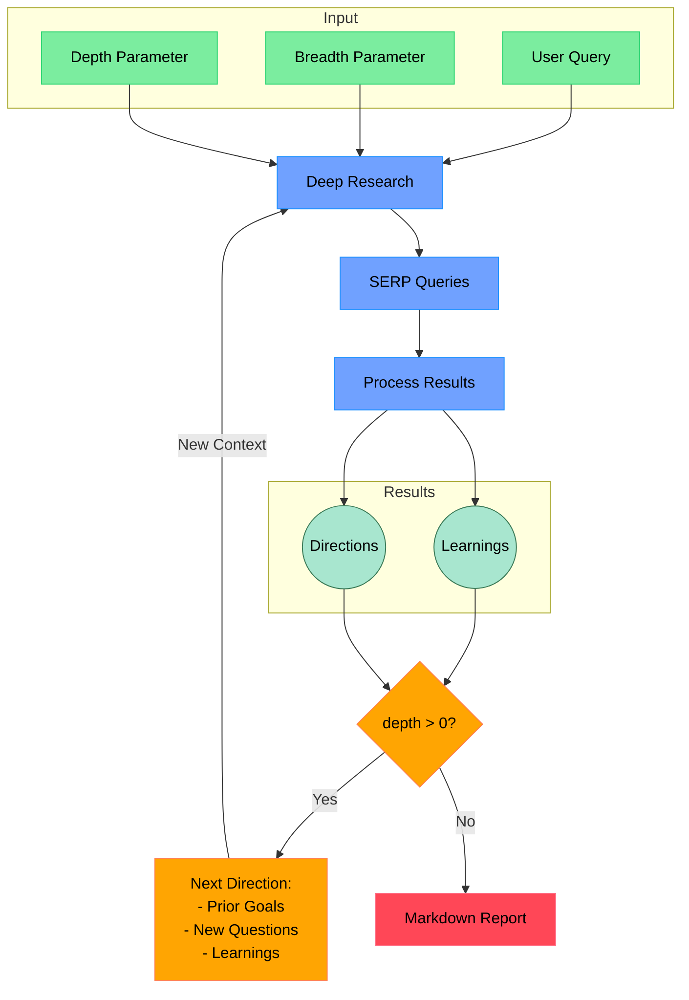

# Open Deep Research

An AI-powered research assistant that performs iterative, deep research on any topic by combining search engines, web scraping, and large language models.

The goal of this repo is to provide the simplest implementation of a deep research agent - e.g. an agent that can refine its research direction over time and deep dive into a topic. Goal is to keep the repo size at <500 LoC so it is easy to understand and build on top of.

If you like this project, please consider starring it and giving me a follow on [X/Twitter](https://x.com/dzhng). This project is created by [Duet](https://duet.so).

## How It Works



## Features

- **Iterative Research**: Performs deep research by iteratively generating search queries, processing results, and diving deeper based on findings
- **Intelligent Query Generation**: Uses LLMs to generate targeted search queries based on research goals and previous findings
- **Depth & Breadth Control**: Configurable parameters to control how wide (breadth) and deep (depth) the research goes
- **Smart Follow-up**: Generates follow-up questions to better understand research needs
- **Comprehensive Reports**: Produces detailed markdown reports with findings and sources
- **Concurrent Processing**: Handles multiple searches and result processing in parallel for efficiency

## Requirements

- Node.js environment
- API keys for:
  - Firecrawl API (for web search and content extraction)
  - One of the following AI providers:
    - **NVIDIA API** (recommended - access to DeepSeek R1, Llama 3.1 405B, Nemotron 70B)
    - **Fireworks AI** (for DeepSeek R1)
    - **OpenAI API** (for GPT-4o-mini)

## Setup

### Node.js

1. Clone the repository
2. Install dependencies:

```bash
npm install
```

3. Set up environment variables in a `.env.local` file:

```bash
FIRECRAWL_KEY="your_firecrawl_key"
# If you want to use your self-hosted Firecrawl, add the following below:
# FIRECRAWL_BASE_URL="http://localhost:3002"

# NVIDIA API (build.nvidia.com) - Recommended
NVIDIA_API_KEY="your_nvidia_api_key"

# Alternative: OpenAI API (fallback)
OPENAI_KEY="your_openai_key"

# Alternative: Fireworks AI (for DeepSeek R1)
# FIREWORKS_KEY="your_fireworks_key"
```

### Model Priority

The system automatically selects the best available model in this order:

1. **DeepSeek R1** (Fireworks) - if `FIREWORKS_KEY` is set
2. **DeepSeek R1** (NVIDIA) - if `NVIDIA_API_KEY` is set ⭐ **Recommended**
3. **Llama 3.1 405B** (NVIDIA) - Most capable model
4. **Nemotron 70B** (NVIDIA) - NVIDIA's research-optimized model
5. **Llama 3.1 70B** (NVIDIA) - Strong general purpose model
6. **GPT-4o-mini** (OpenAI) - Fallback option

To use local LLM, comment out other API keys and instead set `OPENAI_ENDPOINT` and `CUSTOM_MODEL`:

- Set `OPENAI_ENDPOINT` to the address of your local server (eg."http://localhost:1234/v1")
- Set `CUSTOM_MODEL` to the name of the model loaded in your local server.

### NVIDIA API (Recommended)

NVIDIA's build.nvidia.com provides access to state-of-the-art models including:

- **DeepSeek R1**: Excellent reasoning capabilities, perfect for research
- **Llama 3.1 405B**: Most capable open-source model available
- **Nemotron 70B**: NVIDIA's research-optimized model
- **Llama 3.1 70B**: Strong general-purpose model

To get an API key:
1. Visit [build.nvidia.com](https://build.nvidia.com)
2. Sign up for a free account
3. Generate an API key
4. Add it to your `.env.local` as `NVIDIA_API_KEY`

### Docker

1. Clone the repository
2. Rename `.env.example` to `.env.local` and set your API keys

3. Run `docker build -f Dockerfile`

4. Run the Docker image:

```bash
docker compose up -d
```

5. Execute `npm run docker` in the docker service:

```bash
docker exec -it deep-research npm run docker
```

## Usage

Run the research assistant:

```bash
npm start
```

You'll be prompted to:

1. Enter your research query
2. Specify research breadth (recommended: 3-10, default: 4)
3. Specify research depth (recommended: 1-5, default: 2)
4. Answer follow-up questions to refine the research direction

The system will then:

1. Generate and execute search queries
2. Process and analyze search results
3. Recursively explore deeper based on findings
4. Generate a comprehensive markdown report

The final report will be saved as `report.md` or `answer.md` in your working directory, depending on which modes you selected.

### Concurrency

If you have a paid version of Firecrawl or a local version, feel free to increase the `ConcurrencyLimit` by setting the `CONCURRENCY_LIMIT` environment variable so it runs faster.

If you have a free version, you may sometimes run into rate limit errors, you can reduce the limit to 1 (but it will run a lot slower).

### DeepSeek R1

Deep research performs great on R1! You can access DeepSeek R1 through two providers:

#### NVIDIA (Recommended)
```bash
NVIDIA_API_KEY="your_nvidia_api_key"
```

#### Fireworks AI
```bash
FIREWORKS_KEY="your_fireworks_api_key"
```

The system will automatically use Fireworks R1 if both keys are present (higher priority).

### Alternative Providers

For other OpenAI-compatible APIs or local models, you can use these environment variables:

```bash
OPENAI_ENDPOINT="custom_endpoint"
CUSTOM_MODEL="custom_model"
```

These will take the highest priority if set.

## How It Works

1. **Initial Setup**

   - Takes user query and research parameters (breadth & depth)
   - Generates follow-up questions to understand research needs better

2. **Deep Research Process**

   - Generates multiple SERP queries based on research goals
   - Processes search results to extract key learnings
   - Generates follow-up research directions

3. **Recursive Exploration**

   - If depth > 0, takes new research directions and continues exploration
   - Each iteration builds on previous learnings
   - Maintains context of research goals and findings

4. **Report Generation**
   - Compiles all findings into a comprehensive markdown report
   - Includes all sources and references
   - Organizes information in a clear, readable format
  
## Community implementations

**Python**: https://github.com/Finance-LLMs/deep-research-python

## License

MIT License - feel free to use and modify as needed.
